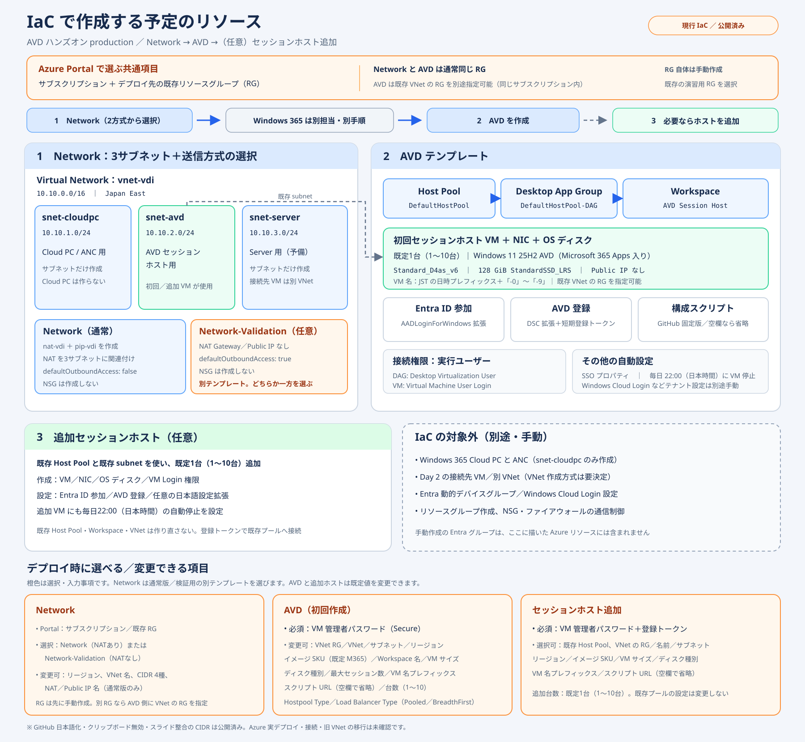

# Day 1 本番用ハンズオン：Network → Windows 365 → AVD

**手動の前提確認・RG 設定 → Network（運用または検証）ボタン → Windows 365 担当パート → AVD ボタン**の順で使う一式です。Network は NAT Gateway あり／なしの2方式を用意し、3サブネットの既定値を保ったままネットワーク設定を変更できます。AVD は接続用 RBAC とホストプールの SSO 設定まで IaC に含めています。既存プールへのホスト追加ボタンと Day 2 セキュアジャンプ演習も用意していますが、ジャンプ先 VNet の作成方式（IaC／手動）は未決定です。

**Network は運用版と検証版を選べます。** 運用版は Standard NAT Gateway と静的 Standard Public IP を作成するため継続費用が発生します。検証版は NAT Gateway／Public IP を作らず、Azure の既定の送信アクセスを使います。Network の Azure 実デプロイ、動的デバイスグループの評価、Windows 365 との通しリハーサル、SSO のシームレスな資格情報フローは未確認です。2026-10-07 の旧版 Network／AVD ボタンでは Windows App 接続成功と日本語化に問題がなさそうとの利用者報告がありますが、[修正一覧](revision-list.md) R10 の確認を講師が済ませてから受講者へ配布してください。

> **自動停止時刻を設定可能（既定19:00、日本時間）：** 初回 AVD／ホスト追加の Deploy ボタンで自動停止の有効・無効、時、分を指定できます。無効で再デプロイすると既存の停止スケジュールも無効になります。VM は毎日停止時刻に停止し、実行中のセッションが中断される場合があります。Azure 実機での所要時間・接続は別途確認が必要です。

> **RDP 2項目も公開済み（2026-10-18）：** CredSSP とビデオ再生の既定値を明示する修正を公開 Deploy ボタンへ反映しました。デバイス／ディスプレイ全体の照合と実機確認は [R19](revision-list.md) に残しています。

> **日本語化スクリプトも GitHub へ移行・公開済み（2026-10-18）：** 初回 AVD／ホスト追加の既定 URL は、同梱スクリプトの固定コミット Raw URL です。空欄での省略は維持しています。OS 日本語化と Windows Update 用で、Office の日本語化は別途 Intune で行います。

> **クリップボード／サブネット修正も公開済み（2026-10-18）：** 新規プールはクリップボード転送を無効にし、両 Network 方式の順序・既定 CIDR を Cloud PC＝`.1`／AVD＝`.2`／Server＝`.3` に揃えました。使用中の旧 VNet を自動移行する変更ではありません。

**元の資料を残して Azure portal を開くには、ボタンを Ctrl＋クリック、マウスの中ボタンクリック、または右クリック →［新しいタブでリンクを開く］で開きます（macOS は Command＋クリック）。** GitHub の README ではリンクの `target="_blank"` が除去されるため、資料側から別タブを強制できません。通常クリックは同じタブで遷移します。



## 1. 受講者が前提確認と RG を手動設定

[Day 1 の統合手順](day1-handson.md)のパート1に従い、指定テナント・サブスクリプションを確認し、講師が指定する任意の名前で演習用 RG を Japan East に手動作成します。両ボタンで同じ既存 RG を選びます。テンプレートは RG を作成しません。

**RG 名は任意です。既定では選択した Network 方式と AVD を同じ RG にデプロイします。** Network の2方式は同じ既定 VNet 名を使うため、1つの VNet にはどちらか一方だけを選びます。既存 VNet が別 RG にある場合は、同じサブスクリプション内の VNet RG を AVD の `Network Resource Group Name` に指定できます。VNet 名とネットワーク CIDR は変更可能です。参加者ごとの環境を分ける場合は、受講者ごとに専用 RG と重複しない VNet 名・CIDR を用意してください。共有・業務用 RG への実行は禁止です。

講師は事前に、利用資格、VM サイズ・イメージ・クォータ、Azure Policy、必要な外向き通信とロール割り当て権限を確認します。**Contributor だけでは AVD の RBAC 作成はできません。**

SSO のテナント側準備は講師が実施します。Microsoft Entra 管理センターの［デバイス］→［リモート接続構成］で **Windows Cloud Login の RDP 認証**を有効化し、Conditional Access／MFA を確認します。これは Azure RG の権限だけでは実施できず、本 ARM には含めません。

## 2. Network を Deploy to Azure

Network のどちらか一方を選んでください。2つのボタンはどちらも既存の RG にデプロイし、同じ既定値で実行すると同じ VNet とサブネットを対象にします。

### 2.1 運用（NAT Gateway あり）

<!-- deploy-button-network:start -->
[](https://portal.azure.com/#create/Microsoft.Template/uri/https%3A%2F%2Fraw.githubusercontent.com%2FYuyanz9%2Favd-hands-on%2F849c03bbb24587227178ceecc71ade8a07fdd2ea%2Ftemplates%2Fnetwork.json)
<!-- deploy-button-network:end -->

**Ctrl＋クリックで、Azure portal を別タブで開けます（macOS は Command＋クリック）。**

使用するテンプレート：[templates/network.json](templates/network.json)。Azure portal でサブスクリプションと手順1で作成した既存の演習用 RG を選び、必要に応じて以下の既定値を変更します。

### 2.2 検証（NAT なし）

<!-- deploy-button-network-validation:start -->
[](https://portal.azure.com/#create/Microsoft.Template/uri/https%3A%2F%2Fraw.githubusercontent.com%2FYuyanz9%2Favd-hands-on%2F849c03bbb24587227178ceecc71ade8a07fdd2ea%2Ftemplates%2Fnetwork-validation.json)
<!-- deploy-button-network-validation:end -->

**Ctrl＋クリックで、Azure portal を別タブで開けます（macOS は Command＋クリック）。**

使用するテンプレート：[templates/network-validation.json](templates/network-validation.json)。既定の送信アクセスで検証する場合はこちらを選びます。NAT Gateway と送信用 Public IP は作成しません。

| 対象 | 既定値・自動処理 |
| --- | --- |
| Location／VNet | `japaneast`／`vnet-vdi`／`10.10.0.0/16`。両方式で変更可能 |
| Cloud PC 用 | `snet-cloudpc`／`10.10.1.0/24`。CIDR は変更可能 |
| AVD 用 | `snet-avd`／`10.10.2.0/24`。CIDR は変更可能 |
| Server 用 | `snet-server`／`10.10.3.0/24`（今回は VM を作らない）。CIDR は変更可能 |
| 運用方式 | `nat-vdi`／`pip-vdi`（名前は変更可能）、Standard NAT Gateway と静的 Standard IPv4 Public IP |
| 検証方式 | NAT Gateway／送信用 Public IP なし。Azure の既定の送信アクセスを使用 |
| サブネット | 運用方式は `defaultOutboundAccess: false` で NAT Gateway を関連付け。検証方式は `true`（プライベート サブネットではない） |

CIDR は VNet の範囲内に収め、サブネット同士が重複しない値を指定してください。記事に合わせ **NSG は未追加**です。受信・東西通信の制御は配布前の検討事項です。既定の送信アクセスは固定・予測可能な送信元 IP を提供しません。VM に Public IP は付けません。Cloud PC 用サブネットだけでは ANC や Cloud PC は作成されません。

**使用中の旧 VNet へ、この修正版の既定値をそのまま再適用しないでください。** 旧版の AVD＝`.3`／Server＝`.2` からの入れ替えは、既存 NIC・VM・Cloud PC／ANC が使うサブネットの自動移行ではありません。変更拒否や通信影響を避けるため、新規の専用 VNet／演習用 RG を使うか、既存 CIDR を入力して維持し、移行が必要なら講師が依存関係と手順を別途承認します。共有 RG／VNet を無断で削除・作り直しません。

**運用版には NAT Gateway と Public IP の継続費用が発生します。** 既存 VNet を NAT ありから検証版へ切り替えると、サブネットの NAT 関連付けは外れますが、増分デプロイでは NAT Gateway／Public IP リソース自体は自動削除されず、料金が続く場合があります。1つの VNet には一方の方式を選び、切り替え時は残存リソースと依存関係を講師が確認してください。

## 3. Windows 365 担当パート

Network の成功と3サブネットを確認後、Windows 365 担当者の資料へ切り替えます。構築手順・ANC・ライセンス・ポリシーの準備は担当側に任せます。ネットワーク情報の受け渡しと AVD へ戻る条件は [統合手順](day1-handson.md#3-windows-365-を構築する担当パート)に記載しています。

## 4. AVD を Deploy to Azure

<!-- deploy-button-avd:start -->
[](https://portal.azure.com/#create/Microsoft.Template/uri/https%3A%2F%2Fraw.githubusercontent.com%2FYuyanz9%2Favd-hands-on%2F849c03bbb24587227178ceecc71ade8a07fdd2ea%2Ftemplates%2Favd.json)
<!-- deploy-button-avd:end -->

**Ctrl＋クリックで、Azure portal を別タブで開けます（macOS は Command＋クリック）。**

使用するテンプレート：[templates/avd.json](templates/avd.json)。パスワード以外は既定値が初期入力され、必要に応じて変更できます。パスワードと既存リソースの名前・配置、イメージ、Workspace 表示名、VM サイズ／ディスク種別、最大セッション数、VM 名プレフィックスに加え、スクリプト URL、台数、ホストプール方式、負荷分散方式を確認してください。

`AVD Users Group Object Id` は既定値のない必須入力です。講師・管理者が Entra セキュリティ グループ `AVD Users` を事前に手動作成し、その Object ID を受講者へ安全に共有してください。

> **入力前に確認：12～123文字が必須です。** 11文字以下だと Azure portal で `InvalidTemplate`（パラメーターの長さ不足）になり、デプロイを開始できません。入力ミスを避けるため14文字以上を推奨します。Windows のパスワード要件として英大文字・英小文字・数字・記号のうち3種類以上を含めてください。これは VM のローカル管理者パスワードで、Entra ID のサインイン用パスワードとは別です。

| 対象 | 既定値・動作 |
| --- | --- |
| ホストプール／DAG | `DefaultHostPool`／`DefaultHostPool-DAG` |
| Workspace | `AVD Session Host` |
| セッションホスト | 既定1台、`Vm Number Of Instances` で1～10台。JST の日時（`AVDMMddHHmm`）＋ `-0`～ `-9`、`Standard_D4as_v6` |
| 管理者／OS ディスク | `vmadmin`／128 GiB、`StandardSSD_LRS` |
| イメージ | 既定 `microsoftwindowsdesktop`／`office-365`／`win11-25h2-avd-m365`／`latest`（Microsoft 365 Apps 入り）。SKU は選択式、Offer は自動連動 |
| ホストプール方式 | `Hostpool Type` は Pooled／Personal（既定 Pooled）。管理方式は Standard |
| 負荷分散 | `Load Balancer Type` は BreadthFirst／DepthFirst（既定 BreadthFirst）。Pooled は最大5セッション／ホストが既定。Personal は Persistent・自動割り当て・1ユーザー／ホスト |
| 参加・保護 | Microsoft Entra ID 参加、Intune MDM 自動登録（既定有効）、Trusted Launch／Secure Boot／vTPM |
| SSO | `enablerdsaadauth:i:1` を常に設定 |
| RDP 追加既定値 | `enablecredsspsupport:i:1`（OS が対応する場合に CredSSP を使用）、`videoplaybackmode:i:1`（可能な場合に RDP 対応マルチメディア ストリーミングを使用） |
| クリップボード転送 | `redirectclipboard:i:0`（新規ホストプールの既定に合わせて無効）。後から RDP プロパティで変更可能 |
| 接続用 RBAC | 手動作成済みの `AVD Users` セキュリティ グループへ DAG の Desktop Virtualization User と各 VM の Virtual Machine User Login |
| 日本語設定等 | `Custom Configuration Script Url` の既定は同梱 [JPNOFLNG.ps1](scripts/JPNOFLNG.ps1) の GitHub 固定コミット URL。空欄なら Custom Script Extension を作らずイメージの言語（通常は英語）のまま高速展開。既定スクリプトは Windows Update と自動再起動を含む |
| 自動停止 | `Enable Automatic Shutdown` は既定 `true`、時は `19`、分は `0`（日本時間）。時は0～23、分は0～59。無効で再デプロイすると既存スケジュールも無効 |

`Intune Enrollment`（`intune`）は既定で `true` です。Entra ID 参加時に Intune MDM 自動登録を要求します。Microsoft Entra ID P1 と適切な Intune ライセンス、テナントの自動 MDM 登録範囲、必要な外向き接続を事前に確認してください。Windows Enterprise multi-session の Intune 管理は Pooled host pool が前提です。Personal pool または Intune を使わない環境では `intune=false` にします。テンプレートはテナントのライセンスや登録範囲を変更しません。[AVD の Entra joined session host](https://learn.microsoft.com/azure/virtual-desktop/azure-ad-joined-session-hosts)、[multi-session の Intune 要件](https://learn.microsoft.com/intune/solutions/azure-virtual-desktop-multi-session)、[Azure VM の MDM 自動登録要件](https://learn.microsoft.com/entra/identity/devices/howto-vm-sign-in-azure-ad-windows)も確認してください。

RDP の2項目は [Microsoft のプロパティ仕様](https://learn.microsoft.com/azure/virtual-desktop/rdp-properties)にある既定値 `1` を明示する変更です。未指定時の「構成されていません」は、実際に無効であることを意味するとは限りません。SSO と音声 `audiomode:i:0` は維持し、クリップボードは[新規ホストプールの既定](https://learn.microsoft.com/azure/virtual-desktop/redirection-configure-clipboard#configure-clipboard-redirection)に合わせて `redirectclipboard:i:0` にしています。デバイス転送や画面設定は、期待値側の［詳細］文字列と比較するまで変更せず、一括で許可しません。今回の実機 GUI 表示・接続は未確認です。ホスト追加テンプレートは既存プールの RDP 設定を変更しません。

後から変更する場合は、Azure portal の［Azure Virtual Desktop］→［ホストプール］→対象プール→［RDP プロパティ］→［デバイスのリダイレクト］でクリップボード転送を有効／無効にして保存し、Windows App のセッションを切断して再接続します。ホストプール全体に適用する設定です。Intune／グループ ポリシー側で禁止している場合は、そちらの変更も必要です。IaC の再適用時はテンプレートの値へ戻るため、継続して有効にするなら管理しているソースも合わせます。

デプロイ前に、講師・管理者が Microsoft Entra 管理センターでセキュリティ グループ `AVD Users` を手動作成し、その Object ID を確認します。テンプレートはグループを作成しません。AVD／ホスト追加の入力欄 `AVD Users Group Object Id` に同じ Object ID を指定すると、初回 AVD では DAG に Desktop Virtualization User、各セッションホスト VM に Virtual Machine User Login を割り当てます。既存プールへのホスト追加では各新規 VM に同じ VM ロールを割り当てます。接続するメンバーをこのグループへ追加してから Windows App で接続します。

テンプレートは Incremental（増分）デプロイです。以前に個別ユーザーへ付与したロール割り当ては自動削除されません。グループ経由のアクセスが確認できた後、不要な既存ユーザー割り当てを DAG／各 VM から手動で確認・削除してください。

AVD は、入力した VNet の RG／名前／サブネットを参照するだけで、Network は再適用しません。**Network Resource Group Name（`networkResourceGroupName`、旧案内の Virtual Network Resource Group Name）は VNet が存在する RG です。** 既定の `[resourceGroup().name]` は portal 上部で選択したデプロイ先 RG を指します。

| 配置 | RG 選択・入力 |
| --- | --- |
| VNet と VM を同じ RG に置く | 上部で VNet がある既存 RG を選択。Network Resource Group Name は既定のまま |
| VM を VNet と別の RG に置く | VM 用 RG を先に手動作成して上部で選択し、**Network Resource Group Name を VNet 側 RG の名前に書き換える**。例：VM は `rg-avd`、VNet は `rg-network` なら上部で `rg-avd` を選び、入力欄には `rg-network` |

別 RG も同じサブスクリプション内に限定し、既存 VNet／サブネットの名前とリージョン、参照・サブネット参加権限を確認します。VM 用 RG の名前を VNet RG として入力したままだと、既存 VNet が見つからず失敗します。

SKU は Windows 11 **23H2／24H2／25H2／26H2 の `-avd` と `-avd-m365`** から選べます。`-m365` は Office 入りの `office-365` Offer、Office なしは `windows-11` Offer を自動指定します。**Microsoft 365 Apps が入っていても Office 利用ライセンスは付与されません。** Office の利用・認証や日本語化の成功を保証せず、研修では Office 操作を必須にしません。Office 日本語化はライセンス・Intune の前提を確認したデモ／説明として別途準備します。各 SKU の提供地域、サポート期限、利用資格は講師が確認してください。

`Custom Configuration Script Url` を空欄にしても、Entra ID 参加、AVD 登録、接続権限、自動停止設定は実行されます。停止の有効・無効と時刻は `Enable Automatic Shutdown`、`Shutdown Hour (Japan Time)`、`Shutdown Minute` で設定します。変更する場合は講師が承認した HTTPS の PowerShell `.ps1` URL だけを使います。ダウンロード・実行エラーはデプロイ失敗として扱い、成功と見なしません。既存 VM に空欄で再適用しても日本語設定を取り消したり、既存の拡張機能を増分デプロイで削除したりするものではありません。

**Personal を選ぶと、Pooled 向けの負荷分散選択と最大セッション数は使わず、Persistent・Automatic・1セッションで作成します。** ユーザーとホストは1対1です。既存プールの方式は変更できないため、別方式を試す場合は講師と既存リソースの保持・削除を確認して新規に作成します。

VM 名の既定プレフィックスはデプロイ時刻から作られ、1回の展開では `-0` から連番を付けます。**ホスト追加や再実行ではプレフィックスを新しくし、既存 VM と重複させません。** 台数増加に応じて VM・ディスク等の費用、vCPU クォータ、サブネット IP 消費も増えます。自動停止は有効時、既定で毎日19:00（日本時間）です。実行中のセッションが中断されることがあり、停止後もディスク・ネットワーク等の料金は残ります。

## 5. 既存プールへセッションホストを追加

<!-- deploy-button-session-host:start -->
[](https://portal.azure.com/#create/Microsoft.Template/uri/https%3A%2F%2Fraw.githubusercontent.com%2FYuyanz9%2Favd-hands-on%2F849c03bbb24587227178ceecc71ade8a07fdd2ea%2Ftemplates%2Fsession-host.json)
<!-- deploy-button-session-host:end -->

**Ctrl＋クリックで、Azure portal を別タブで開けます（macOS は Command＋クリック）。**

使用するテンプレート：[templates/session-host.json](templates/session-host.json)。このテンプレートは既存の Standard 管理ホストプールへ VM を既定1台、1回につき1～10台追加します。**台数は追加分であり、プール全体の目標台数ではありません。** 既存のホストプール、アプリケーショングループ、Workspace は作成・更新しません。Azure portal で新しい VM の配置先 RG を選びます。VNet が別 RG の場合は、上の配置表と同様に **Network Resource Group Name を VNet 側 RG に変更**してください。プールの RG は登録キーを発行する場所で、VM の配置先 RG と区別します。

デプロイ前に対象ホストプールで有効な登録キーを発行し、Secure registration token 欄へ貼り付けます。トークンと VM ローカル管理者パスワードは秘密情報として扱い、ファイル・チャット・スクリーンショットへ保存しません。イメージ、VM サイズ、リージョン、サブネットは既存プールと互換性があることを講師が確認してください。既定名は日時プレフィックス＋ `-0` からの連番です。既存ホストとの名前衝突を避け、再実行時はプレフィックスを変更します。自動停止は既定で有効、毎日19:00（日本時間）です。停止を無効にして再デプロイすると既存スケジュールも無効になります。

| 入力項目 | 既定値 | 用途・注意 |
| --- | --- | --- |
| AVD Users Group Object Id | 既定値なし | 手動作成済みの `AVD Users` セキュリティ グループの Object ID。必須 |
| Existing Host Pool Name | `DefaultHostPool` | 登録キーを作成した対象の Standard 管理プール |
| Network Resource Group Name | 選択したデプロイ先 RG | 同じ RG なら既定のまま。別 RG なら **VNet 側 RG の名前**に変更 |
| Existing Vnet Name／Existing Subnet Name | `vnet-vdi`／`snet-avd` | 対象プールで利用する既存ネットワーク |
| Location | `japaneast` | VNet と既存プールに合わせる |
| Vm Gallery Image SKU | `win11-25h2-avd-m365` | Office 入り。既存ホストと互換の SKU をリストから選択。Offer は連動 |
| Vm Size／Vm Disk Type | `Standard_D4as_v6`／`StandardSSD_LRS` | 既存プールに合わせる |
| Vm Name Prefix | JST の日時 `AVDMMddHHmm` | 実行時刻が近い場合は一意になる値へ変更 |
| Custom Configuration Script Url | `https://raw.githubusercontent.com/Yuyanz9/avd-hands-on/7b0923fcc78335ac25bafc418d9d3ab4538292d8/scripts/JPNOFLNG.ps1` | GitHub 固定コミット。空欄なら日本語設定を省略 |
| Vm Number Of Instances | `1` | 追加する台数。1～10台。費用・クォータを確認 |
| Enable Automatic Shutdown／Shutdown Hour (Japan Time)／Shutdown Minute | `true`／`19`／`0` | 日本時間の毎日停止。時は0～23、分は0～59。無効で再デプロイするとスケジュールも無効 |
| Registration Token／Vm Administrator Account Password | 既定なし | 必須の secure parameter。秘密を保存しない |

## 6. 動的デバイスグループ（任意・手動）

動的デバイスグループは、作成済みの AVD セッションホストや Windows 365 Cloud PC に Intune などのデバイス ポリシーを割り当てるためのものです。**AVD ホストの作成・プールへの登録にも、Windows 365 の Cloud PC プロビジョニングにも必須ではありません。** Entra 管理センターで［グループ］→［新しいグループ］を開き、グループの種類を［セキュリティ］、メンバーシップの種類を［動的デバイス］にして作成します。

| 対象 | グループ名の例 | 動的メンバーシップ ルール |
| --- | --- | --- |
| AVD セッションホスト | `AVD-SessionHosts` | `(device.displayName -startsWith "AVD")` |
| Windows 365 Cloud PC | `Windows365-CloudPCs` | `(device.deviceModel -startsWith "Cloud PC") -or (device.deviceModel -startsWith "Windows 365")` |

AVD のルールは VM 名プレフィックス `AVD` を前提にします。既定プレフィックスから変更した場合はルールも合わせてください。ポリシーを割り当てる前に、ルール検証と実際のデバイス オブジェクトで対象・除外を確認します。動的グループの評価には時間がかかることがあります。動的メンバーシップ機能の利用条件・ライセンスは講師がテナントで確認してください。

Windows 365 のプロビジョニング ポリシーを割り当てる対象は **ユーザー グループ**です。Cloud PC の動的デバイスグループとは別の用途なので、混同しないでください。これらの Entra グループは本テンプレートでは作成しません。

## 記事からの意図的な変更と未確認事項

- VM 名プレフィックス、VM サイズ、ディスク種別、イメージ SKU、最大セッション数、VNet／サブネット名、配置 RG、ロケーション、Workspace 表示名は既定値を確認・変更できます。名前の重複や VNet とリージョンの不整合を避けます。
- AVD と追加ホストの VM は自動停止を既定で有効にし、毎日19:00（日本時間）に停止します。Deploy ボタンで有効・無効と時・分を指定でき、無効で再デプロイすると既存スケジュールも無効になります。Day 2 のセキュアジャンプ VM は IaC 対象外で、手動で22:00停止を設定します。
- Network は運用版（NAT Gateway／静的 Public IP、`defaultOutboundAccess: false`）と検証版（NAT なし、`defaultOutboundAccess: true`）から選びます。運用版には継続費用がかかり、検証版の既定送信元 IP は固定されません。
- 接続権限2種類とホストプール SSO を自動設定します。Windows Cloud Login のテナント側準備は講師担当です。

イメージの `latest`、DSC パッケージ、PowerShell Gallery のモジュールと Windows Update は外部依存です。既定の日本語化スクリプト本体は GitHub 固定コミットで不変化していますが、これらの依存先までは固定しません。**自動再起動による拡張機能の失敗・待機時間を含め未実証**です。配布前に通しリハーサルし、依存先の版固定・再起動方式の調整要否を判断します。デプロイ成功と SSO 接続成功は別の確認です。

### セキュリティ上の注意：外部スクリプト

AVD テンプレートは公開 GitHub の固定コミットから [JPNOFLNG.ps1](scripts/JPNOFLNG.ps1) を取得し、Custom Script Extension で `ExecutionPolicy Bypass` を指定して VM 上で実行します。出典は carol0226 氏の OS 日本語化スクリプトで、[公開の参考記事](https://qiita.com/carol0226/items/f7770369947aaf4962f7)を参照してください。記事掲載の処理を維持し、出典コメントだけを付けています。**このスクリプトは OS 日本語化と Windows Update 用です。Microsoft 365 Apps の日本語化は含まず、別途 Intune の設定・ライセンス確認が必要です。**

配信する LF 改行版スクリプトの SHA-256 は `5C55DB8A3C2394F1AFBE2125F950753ED2DFFE602578C963504F617EAE46FAE4` です。公開時に匿名取得と内容一致を照合しました。Windows のチェックアウトで CRLF に変換された場合、ファイルの生バイトのハッシュは異なります。実行時の VM 内ハッシュ／署名検証は未実装です。`PSWindowsUpdate` は引き続きバージョン指定なしで導入・実行するため、依存モジュール等の変更によるサプライチェーンリスクは残ります。URL を別の配信元や可変ブランチへ変更した場合は、既定の不変配信による保証も対象外です。

**この教材・スクリプトに悪意あるコードを加えること、実行先を不審なスクリプトに差し替えること、未承認の変更を配布・実行することを禁止します。** デプロイ前に講師が配信元と内容を確認し、承認できない場合は［作成］を進めないでください。この注意書き自体は技術的な改変防止策ではありません。本番利用前に R09 の確認と残る対策が必要です。

流用スクリーンショットは旧テンプレートの参考で、新版の入力画面ではありません。新しい画面の撮影は実機リハーサル時に行います。費用・保持・削除の注意は [統合手順](day1-handson.md)を参照してください。

## 講師・作成者向け：生成と配信リンクの準備

Network の編集可能な既定値と AVD の変更しない基礎設定は [infra/settings.json](infra/settings.json)および対応する Bicep のパラメーターに記載しています。Network の portal 既定値は settings と一致するよう契約テストで検証します。このフォルダーを作業ディレクトリにして PowerShell 7 と Azure CLI の Bicep コンパイラーで実行します。ローカル生成は Bicep 0.42.1 で確認しています。以下は Azure ログインやデプロイを行いません。

```powershell
.\scripts\Build-Templates.ps1
.\tests\Test-ProductionTemplates.ps1
```

AVD のモジュールは生成 JSON に埋め込まれ、リモート Bicep や別の ARM テンプレートの配信は不要です。生成後はソースと JSON をセットで管理してください。

現在のボタンは、[配信管理データ](resources/deploy-links.json)に記録した公開コミット `849c03bbb24587227178ceecc71ade8a07fdd2ea` の ARM JSON に固定しています。4つの URL は匿名取得・JSON 解析・同梱 JSON との SHA-256 一致を確認済みです。日本語化スクリプトの GitHub 固定 URL、クリップボード無効、スライドに合わせたサブネット順と CIDR、CredSSP／ビデオ再生の明示に加え、AVD Users グループと自動停止の有効・無効・時・分の入力を反映します。今後更新する際も、**テンプレートが含まれる40桁のコミット SHA**でボタンを設定し、匿名取得とハッシュ照合をやり直します。テンプレート配信・Portal 入力画面の確認と、Azure リソース作成・実接続の確認は別です。

```powershell
.\scripts\Set-DeployButtons.ps1 `
    -Repository '<公開先owner>/<公開先repo>' `
    -TemplateCommit '<テンプレートを含む40桁のコミットSHA>'
```

公開 repo 内のサブフォルダーに置く場合は `-TemplatePathPrefix 'avd-hands-on/production'` 等を指定します。スクリプトはローカル README と [配信管理データ](resources/deploy-links.json)のみを更新し、repo 作成・公開・push はしません。再実行後は4つの raw URL を匿名取得し、ローカルファイルとの SHA-256 一致を確認するまで管理データの `rawUrlsVerified` を `false` のままにします。

ボタンは [Microsoft 公式の README パターン](https://learn.microsoft.com/ja-jp/azure/azure-resource-manager/templates/deploy-to-azure-button)に沿い、公開 raw ARM JSON の URL をエンコードして Azure portal へ渡します。**非公開 GitHub repo の raw URL はそのままでは ARM が取得できません。** 配信時は固定コミットのファイルが匿名取得でき、同梱 JSON のハッシュと一致することを確認してから、ボタンを配布します。

この公開 repo は `avd-hands-on\production\` の一式だけをルートに配置しています。元の非公開 `M-Training` repo はそのままです。親の内部資料・PowerPoint・顧客固有情報は含めていません。

## 関連資料

| 資料 | 用途 |
| --- | --- |
| [Day 1 統合手順](day1-handson.md) | 受講者・講師の進行と完了条件 |
| [Day 2 セキュアジャンプ手順](day2-secure-jump.md) | VNet 作成方式（IaC／手動）の決定待ち。現行手順は手動作成案 |
| [修正一覧](revision-list.md) | 実装済みと配布前の残作業 |
| [流用一覧](reuse-inventory.md) | 比較用素材と新規 IaC の区別 |
| [画像の出典](resources/images/README.md) | 加工・利用許可・旧画面の制約 |
| [コピー記録](resources/reuse-manifest.json) | 取り込み時点の出典とハッシュ |
