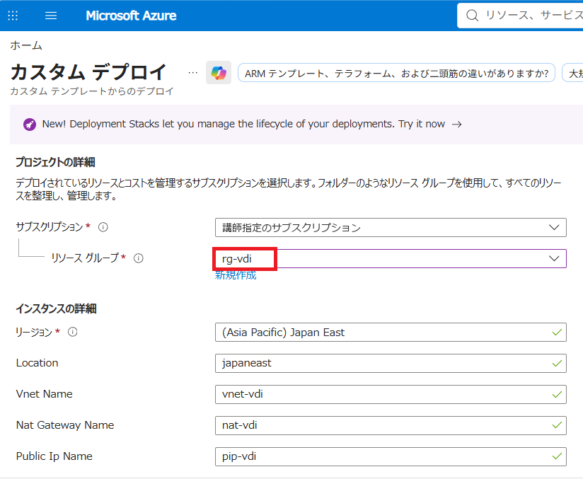
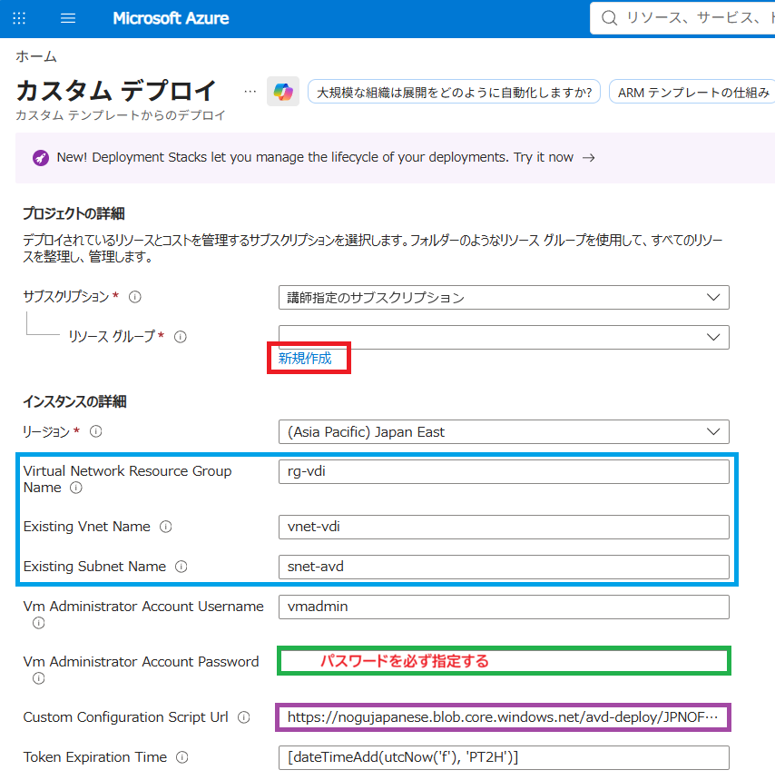
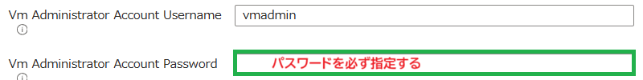

# Day 1：手動準備から Windows 365・AVD の構築へ

> **公開済み・今回の Network 2方式は実機確認前です。** 運用版は NAT Gateway と静的 Public IP を作成し、検証版は NAT なしで既定の送信アクセスを使います。両方式とも VNet／サブネットの既定値を変更できます。Network の Azure 実行、動的グループの評価、Windows 365 との通しリハーサルと SSO のシームレスな資格情報フローは未確認です。[残項目](revision-list.md) R10・R18 を講師が確認してから受講者へ配布してください。掲載画像は記事・旧資料の参考で、今回のテンプレートの実行結果ではありません。

> **新版公開済み（2026-10-18）：** 初回構築・ホスト追加とも、英語での新規展開を早めるには `Custom Configuration Script Url` の既定 URL を消して空欄にします。日本語設定を省略しても Entra ID 参加・AVD 登録・RBAC・22時停止は設定します。SKU 選択、台数などの新しい入力も公開ボタンから利用できます。Azure 実機での所要時間・接続は未確認です。

> **RDP 2項目も公開済み（2026-10-18）：** CredSSP とビデオ再生の既定値を明示する修正を公開ボタンへ反映しました。デバイス／ディスプレイ全体の照合は [R19](revision-list.md) の残課題です。

> **日本語化スクリプトも GitHub へ移行・公開済み（2026-10-18）：** 初回 AVD／ホスト追加とも、同梱スクリプトの GitHub 固定コミット Raw URL が既定です。空欄で省略可能。OS 日本語化と Windows Update 用で、Office は別途 Intune の設定が必要です。

> **クリップボード／サブネット修正も公開済み（2026-10-18）：** 新規プールのクリップボードは無効、両 Network 方式は Cloud PC＝`.1`／AVD＝`.2`／Server＝`.3` の順・既定値です。使用中の旧 VNet へそのまま再適用せず、以下の移行注意を確認します。

## 今回の進み方

**前提確認・RG 設定【手動】 → Network【Deploy to Azure】 → Windows 365【担当パート】 → AVD・接続権限・SSO【Deploy to Azure】**

受講者は PowerShell、Azure CLI、Bicep のコマンドを実行しません。リソースグループは IaC 実行前に手動で作成・確認します。AVD の各テンプレートには既定値が入り、portal で必要に応じて変更できます。

| パート | 次へ進むための条件 |
| --- | --- |
| 手動準備 | 指定テナント・サブスクリプション、講師指定の演習用 RG、権限、講師の SSO 準備を確認 |
| Network | 選んだ方式に応じ、VNet・3サブネット・送信設定を確認 |
| Windows 365 | 担当者が区切りまでの完了と AVD への移行を案内 |
| AVD | リソース・接続権限・SSO 設定に加え、登録・拡張機能・実接続を確認 |

処理時間は保証しません。VM、ディスク等には料金が発生し、ブラウザーを閉じても削除されません。既存環境に旧 NAT Gateway／Public IP が残っている場合は別途費用が続くことがあります。

## 1. 前提確認・リソースグループの設定【手動】

### 1.1 講師・管理者の事前準備

| 項目 | 準備・確認すること |
| --- | --- |
| 対象環境 | テナントとサブスクリプションを個別案内。実 ID を公開資料に記載しない |
| 演習の分離 | VNet 等の名前が既定値のままでは同一 RG に複数環境を作れない。受講者ごとに専用 RG を用意し、名前を変更する場合は講師が事前確認 |
| 利用者・ライセンス | 対象テナントのメンバーアカウント、AVD と Windows 365 の利用資格 |
| Azure の権限 | RG 作成権限、リソース作成権限、DAG と VM に必要な RBAC を割り当てる権限。Contributor のみでは不足 |
| プロバイダー | `Microsoft.Network`、`Microsoft.Compute`、`Microsoft.DesktopVirtualization` の登録 |
| SKU・イメージ | Japan East の `Standard_D4as_v6`、指定台数分の vCPU クォータ、既定の Microsoft 365 Apps 入り Windows 11 25H2 AVD イメージ（選択変更時はその SKU）、Trusted Launch の利用可否。Apps の利用ライセンスは別途確認 |
| 通信・制約 | AVD、Entra ID、更新、構成パッケージ等への外向き通信。Azure Policy、Conditional Access／MFA |
| SSO のテナント設定 | Windows Cloud Login の RDP 認証有効化。以下の講師準備を実施 |
| 運用 | Windows 365 側の準備、Day 2 保持、停止・削除日、残存費用 |

SSO 準備は Microsoft Entra 管理センターの［デバイス］→［リモート接続構成］→［Windows Cloud Login］で行います。Application Administrator／Cloud Application Administrator 等の必要な Entra 権限を持つ講師・管理者が RDP 認証を有効化し、適用される認証・MFA・Conditional Access を確認します。**本 ARM はこのテナント設定を変更しません。**

[Microsoft の SSO 設定手順](https://learn.microsoft.com/azure/virtual-desktop/configure-single-sign-on)を参照します。受講者へのサブスクリプション全体の Owner 一律付与や、Conditional Access の無効化を前提にしません。

### 1.2 受講者：対象環境を確認

1. [Azure portal](https://portal.azure.com/) に講師指定のメンバーアカウントでサインインします。このアカウントで後の AVD デプロイと接続も行います。
2. ディレクトリ切り替えで対象テナントを選び、名前・ID を個別案内と照合します。
3. ［サブスクリプション］で対象の名前・ID を照合します。別テナント・業務用の環境へ実行しません。
4. 講師とリソース作成・ロール割り当て権限、SSO の事前準備を確認します。

### 1.3 受講者：演習用 RG を手動設定

1. ［リソース グループ］→［作成］を開きます。講師が事前作成した場合は指定 RG を開きます。
2. 指定サブスクリプション、講師が指定する RG 名（例：`rg-vdi`）、リージョン **Japan East** を選びます。
3. 記事に合わせ必須タグは設けません。既存 Bicep 版の `training`／`participant` タグや削除スクリプトは使用しません。
4. ［確認および作成］で確認後に作成し、RG の［概要］と［アクセス制御（IAM）］で対象と必要権限を確認します。

RG 新規作成画面は実機リハーサルで撮影予定です。旧タグ画面は[流用一覧](reuse-inventory.md)に保管していますが、この手順の必須設定ではありません。

**完了条件：** 指定環境に演習用 RG が存在し、Japan East と権限を確認済みであること。RG 名はテンプレートに固定されていません。既定構成では Network と AVD の両方で同じ RG を選びます。別 RG の既存 VNet を使う場合は AVD の VNet RG 欄を変更します。

## 2. VNet 等の共通基盤を構築する【Deploy to Azure】

### 2.1 Network ボタンと変更可能な既定値

[README の Network ボタン欄](README.md#2-network-を-deploy-to-azure)から**運用版か検証版のどちらか一方**を選びます。運用版は [network.json](templates/network.json)、検証版は [network-validation.json](templates/network-validation.json) の固定コミット版を参照します。どちらも手順1で作成した既存 RG を選びます。2方式に同じ VNet 名を指定して同じ RG に続けてデプロイすると、サブネット設定が切り替わるため、意図した場合以外は行いません。

*旧画面の参考です。新版では編集可能な既定値が表示されます。この画像は今回の入力画面ではありません。サブスクリプション表示は加工済みです。*

| 入力／設定 | 既定値・動作 |
| --- | --- |
| Location／VNet | `japaneast`／`vnet-vdi`／`10.10.0.0/16`。両方式で変更可能 |
| Cloud PC 用サブネット | `snet-cloudpc`／`10.10.1.0/24`。CIDR は変更可能 |
| AVD 用サブネット | `snet-avd`／`10.10.2.0/24`。CIDR は変更可能 |
| Server 用サブネット | `snet-server`／`10.10.3.0/24`。CIDR は変更可能 |
| 運用方式 | NAT Gateway `nat-vdi`／Public IP `pip-vdi`。名前は変更可能。Standard NAT Gateway と静的 Standard IPv4 Public IP を作成 |
| 検証方式 | NAT Gateway／送信用 Public IP は作成せず、Azure の既定の送信アクセスを使用 |
| 送信設定 | 運用方式は `defaultOutboundAccess: false` で NAT を関連付け。検証方式は `defaultOutboundAccess: true`（プライベート サブネットではない） |
| NSG | 記事同様に作成しない。受信・東西通信の制御は配布前に確認 |

CIDR は VNet の範囲内に収め、サブネット同士が重複しない値を入力します。**運用方式には NAT Gateway と Public IP の継続費用が発生します。** 既定の送信アクセスは固定・予測可能な送信元 IP を提供しません。

**使用中の旧 VNet に修正版の既定値をそのまま再適用しません。** 旧版の AVD＝`.3`／Server＝`.2` を、使用中の NIC・VM・Cloud PC／ANC ごと自動移行する機能ではありません。新規の専用 VNet／演習用 RG を使うか、既存 CIDR を入力して維持します。移行や削除は講師が依存関係を確認し、別途承認した手順で行います。

### 2.2 公開・リハーサル完了後の操作

1. 選んだ Network ボタンで［カスタム デプロイ］を開き、講師が承認した方式・テンプレートであることを確認します。
2. 手順1と同じサブスクリプションと **既存の演習用 RG** を選びます。RG 名は任意です。後の AVD では同じ RG を既定値として使います。新規 RG は作成しません。
3. Location、VNet 名・CIDR、各サブネット CIDR を確認し、必要な場合だけ既定値を変更します。CIDR が重複せず VNet 範囲に収まることを確認します。
4. ［確認および作成］で検証結果を確認し、講師の案内に従って［作成］します。
5. RG の［デプロイ］で成功を確認します。VNet の［サブネット］で3つの範囲と選択方式の送信設定を確認します。運用方式では NAT Gateway と Public IP の作成・関連付けも確認します。

NAT ありから検証方式へ切り替える場合、増分デプロイでは NAT Gateway／Public IP リソース自体は自動削除されず、料金が続く場合があります。残存リソースと依存関係を講師が確認し、別途承認された手順で扱います。Server 用の VM、Cloud PC、ANC はこのテンプレートでは作成しません。旧 Bicep の2サブネット構成を重ねて実行しません。

**完了条件：** 3サブネットが存在し、選んだ方式に沿った `defaultOutboundAccess`／NAT 関連付けを確認して Windows 365 担当者へ方式とネットワーク情報を渡せること。

## 3. Windows 365 を構築する【担当パート】

ここから Windows 365 担当者の資料へ切り替えます。**構築手順・ANC・ライセンス・ポリシーの準備は担当側に任せ、本資料では代わりに実装しません。**

| 受け渡す情報 | 内容 |
| --- | --- |
| 環境 | 指定テナント・サブスクリプション、講師指定の演習用 RG／Japan East |
| ネットワーク | 選択した VNet 名と `snet-cloudpc` の実リソース ID、名前、アドレス。VNet／CIDR を変更した場合はその値を伝える |
| 制御・状態 | 選択した Network 方式（運用 NAT あり／検証 NAT なし）、NSG なし、Network の成功 |
| 運用 | 保持・削除予定、課題、AVD へ戻るタイミング |

実 ID やアカウント情報は個別の運営連絡で共有します。ANC 方式か Microsoft ホスト型ネットワークか、共通 VNet を使うか、必要な通信・権限は担当者と配布前に照合します。

担当者が区切りまでの完了と AVD へ進んでよいことを案内します。**Windows 365 後に Network を再実行しません。** 再適用が必要な場合は講師がサブネット・ANC への影響を確認します。

## 4. AVD を構築する【Deploy to Azure】

### 4.1 AVD ボタンと入力

[README の AVD ボタン欄](README.md#4-avd-を-deploy-to-azure)を使用します。**今回の Office 入り既定値・SKU 選択・追加4項目はローカル更新版で、ボタンはまだ前回公開版です。新版公開・ボタン更新・ハッシュ照合後に演習を実施してください。** 同梱 [avd.json](templates/avd.json) は旧記事の汎用テンプレートとは異なり、Azure デプロイ・SSO 接続は未リハーサルです。資料を残すにはボタンを **Ctrl＋クリック／中ボタンクリック／右クリック →［新しいタブでリンクを開く］**で開きます（macOS は Command＋クリック）。GitHub README 側から別タブは強制できません。

*旧画像の［新規作成］は使用せず、AVD リソースを作成する RG を選びます。画像は旧版の参考で、新版の入力欄・初期値を示しません。*

標準値が事前入力されます。**VNet と同じ RG に VM を置く場合は、上部で VNet のある既存 RG を選び、Network Resource Group Name は既定のままにします。別 RG に置く場合は VM 用 RG を先に手動作成して上部で選び、Network Resource Group Name を VNet 側 RG の名前へ変更します。** 例：上部で `rg-avd` を選び、VNet が `rg-network` にある場合は入力欄に `rg-network` と指定します。`[resourceGroup().name]` のままだと VM 用 RG を参照し、VNet が見つからず失敗します。同じサブスクリプション内に限定し、参照・サブネット参加権限、VNet／サブネット名とリージョンを講師が確認してください。AVD は Network・Cloud PC・ANC を作成・再適用しません。

ローカル管理者名は `vmadmin` です。パスワード以外の入力値には既定値があります。

| 入力項目 | 既定値 | 用途・注意 |
| --- | --- | --- |
| Network Resource Group Name（旧案内：Virtual Network Resource Group Name） | 選択したデプロイ先 RG | 既存 VNet の RG。同じ RG なら既定のまま、別 RG なら VNet 側 RG に変更 |
| Existing Vnet Name | `vnet-vdi` | 既存の VNet |
| Existing Subnet Name | `snet-avd` | セッションホスト用サブネット |
| Location | `japaneast` | VNet のリージョンと一致させる |
| Vm Gallery Image SKU | `win11-25h2-avd-m365` | Office 入りが既定。Windows 11 23H2～26H2 の Office あり／なしを選択。Offer は自動連動 |
| Work Space Name | `AVD Session Host` | Windows App に表示する Workspace 名 |
| Vm Size | `Standard_D4as_v6` | クォータ・リージョン対応を確認 |
| Vm Disk Type | `StandardSSD_LRS` | VM サイズ・リージョンで利用可能な種別 |
| Max Session Limit | `5` | Pooled の各ホストの最大同時セッション数。Personal は1 |
| Vm Name Prefix | `dateTimeAdd(utcNow(), 'PT9H', 'AVDMMddHHmm')` | 初期値は JST の分単位。VM 名は `-0`～ `-9` を付加。再実行は新しい値に変更 |
| Custom Configuration Script Url | `https://raw.githubusercontent.com/Yuyanz9/avd-hands-on/7b0923fcc78335ac25bafc418d9d3ab4538292d8/scripts/JPNOFLNG.ps1` | GitHub 固定コミット。既定は日本語設定、空欄なら省略しイメージの言語（通常は英語）で高速展開 |
| Vm Number Of Instances | `1` | 1回で作る台数。1～10台。費用・vCPU クォータ・IP 容量を確認 |
| Hostpool Type | `Pooled` | Pooled／Personal を選択。既存プールの方式変更は不可 |
| Load Balancer Type | `BreadthFirst` | Pooled は BreadthFirst／DepthFirst。Personal はこの入力を使わず Persistent・自動割り当て |
| Vm Administrator Account Password | なし | ローカル管理者 `vmadmin` の secure password |

> **入力前に必ず確認：12～123文字が必須です。** 11文字以下では `InvalidTemplate`（パラメーターの長さ不足）となり、デプロイを開始できません。入力ミス防止のため14文字以上を推奨します。英大文字・英小文字・数字・記号のうち3種類以上を使い、Azure VM のパスワード要件を満たしてください。

研修専用のローカル管理者パスワードを使い、テナントのサインイン用パスワードとは分けます。ファイル・チャット・スクリーンショットに保存しません。

### 4.2 自動で作られるもの

| 対象 | 既定値・自動処理 |
| --- | --- |
| ホストプール | `DefaultHostPool`、既定 Pooled／Standard／BreadthFirst、各ホスト最大5セッション。Personal は Persistent／Automatic／1セッション |
| DAG／Workspace | `DefaultHostPool-DAG`／`AVD Session Host`、Workspace へ DAG 登録 |
| VM | 既定1台、1～10台を指定可能。JST の日時プレフィックス＋ `-0`～ `-9`、既定 `Standard_D4as_v6`、128 GiB `StandardSSD_LRS` |
| OS | 既定 `microsoftwindowsdesktop`／`office-365`／`win11-25h2-avd-m365`／`latest`（Microsoft 365 Apps 入り）。Office なし SKU は `windows-11` Offer |
| ID・保護 | Entra ID 参加、システム割り当て ID、Intune なし、Trusted Launch／Secure Boot／vTPM |
| 接続権限 | 実行したユーザーへ DAG の Desktop Virtualization User と VM の Virtual Machine User Login |
| SSO | ホストプールへ `enablerdsaadauth:i:1` を設定 |
| RDP 追加既定値 | `enablecredsspsupport:i:1` と `videoplaybackmode:i:1` を明示。SSO・音声設定は維持 |
| クリップボード転送 | `redirectclipboard:i:0` で無効。後からホストプールの RDP プロパティで変更可能 |
| 登録 | Entra ID 参加 → DSC による AVD 登録。登録トークンは2時間、保護設定にのみ格納 |
| 日本語設定等 | URL がある場合のみ登録後に Custom Script を実行。既定 `JPNOFLNG.ps1` は Windows Update・自動再起動を含む。空欄なら拡張機能を作らない |
| 自動停止 | 毎日22:00（`Tokyo Standard Time`）。実行中のセッションが中断される場合あり |

RDP 2項目は未指定から [Microsoft の仕様上の既定値](https://learn.microsoft.com/azure/virtual-desktop/rdp-properties) `1` を明示する修正で、実際に作成したホストプールの GUI 表示・接続は未確認です。「構成されていません」だけでは機能が無効とは断定できません。残るデバイス／画面設定は期待値側の［詳細］文字列と比較するまで変更せず、Intune／グループ ポリシーの制限も別途確認します。

クリップボードは新規ホストプールの既定に合わせて無効です。後から有効にする場合は［ホストプール］→対象プール→［RDP プロパティ］→［デバイスのリダイレクト］で変更・保存し、セッションを切断して再接続します。Intune／グループ ポリシーで禁止されている場合はそちらも変更します。追加ホストのボタンだけでは既存プールの設定は変わらず、初回 AVD テンプレートの再適用時は無効へ戻るため、継続運用ではソースも合わせて管理します。
1回の展開で指定した台数には同じプレフィックスと異なる連番が付きます。追加・再実行時は既存 VM と重複しないプレフィックスを使います。台数を増やすと費用・クォータ・IP 消費も増えます。SKU の提供地域とサポート期限は事前に確認します。既定スクリプト本体は GitHub 固定コミットですが、イメージの `latest`、依存モジュールと Windows Update の取得内容は変わり得ます。サイズ・イメージの利用可否と、スクリプトの再起動・拡張機能結果は配布前の実機確認が必要です。

スクリプト URL が空欄でも Entra ID 参加、AVD 登録、各 VM の RBAC と22時停止は実行します。英語版の新規 VM を素早く作るための選択であり、既存 VM の日本語化の取り消しや拡張機能の削除ではありません。URL を変更する場合は承認済み HTTPS の PowerShell `.ps1` を指定します。**Microsoft 365 Apps が入っていても Office 利用ライセンスは付与されません。** Office 操作を必須にせず、日本語化のデモ／Intune の説明は利用条件を確認して別途準備します。

AVD の日本語設定拡張機能は、同梱 [JPNOFLNG.ps1](scripts/JPNOFLNG.ps1) の GitHub 固定コミットを `ExecutionPolicy Bypass` で実行します。**このスクリプトは OS 日本語化と Windows Update 用です。Microsoft 365 Apps の日本語化は含まず、別途 Intune の設定が必要です。** 本体の匿名取得・照合は確認済みですが、VM 内でのハッシュ／署名検証は未実装で、バージョン未固定の `PSWindowsUpdate` 等の外部依存も残ります。**悪意あるコードの追加・スクリプトの不審な差し替え・未承認の変更の配布や実行は禁止です。** 講師が配信元と実行内容を確認できない場合はデプロイせず、詳細は [README のセキュリティ注意](README.md)を確認してください。この注意書き自体はコード改変や依存先の変更を防止しません。

**本人がデプロイして本人が接続**します。Object ID は `deployer().objectId` で取得し、2種類のロールをリソース単位で付与します。サービスプリンシパル・グループは対象外です。講師が別アカウントで再実行すると、その講師にも権限が追加されるため代行前に確認します。

### 4.3 検証・作成・状態確認

1. 同じアカウントとサブスクリプションで、AVD リソースを作成する RG を選びます。各既定値を確認し、必要な場合だけ変更してパスワードを入力します。別 RG の VNet を使うときは `Network Resource Group Name` を VNet 側 RG の名前に変更します。
2. ［確認および作成］で検証結果を確認します。エラー時は実行せず、講師と原因を確認します。受講者判断でリージョン・サイズ・ネットワークを変更しません。
3. ［作成］後、RG の［デプロイ］で結果を確認します。失敗を成功と扱わず、デプロイ名・失敗リソース・エラーを講師に共有します。秘密を共有しません。
4. 各 VM の［拡張機能とアプリケーション］で Entra ID 参加・DSC の成功を確認します。URL を指定した場合だけ Custom Script の成功も確認し、空欄の場合は新規 VM に Custom Script がないことを確認します。自動再起動の途中では接続確認に進みません。
5. ホストプールの［セッション ホスト］で指定台数の VM 名が登録され `Available` であることを確認します。各 NIC に Public IP がないことを確認します。
6. DAG の［割り当て］と［アクセス制御（IAM）］で自分の Desktop Virtualization User、VM の［アクセス制御（IAM）］で Virtual Machine User Login を確認します。
7. ホストプールの［RDP プロパティ］で SSO 設定を確認します。テナント側の Windows Cloud Login 準備は講師に確認します。
8. VM の［自動シャットダウン］で毎日22:00（日本時間）のスケジュールが有効であることを確認します。作業中のセッションも停止時刻に中断され得ることを確認します。

登録・拡張機能の失敗や RBAC の不足があれば停止し、講師へ引き継ぎます。AVD の復旧時に Network を再実行・削除しません。VM 名の重複や既存 VM の更新を避けるため、講師の確認なく再実行しません。

### 4.4 Windows App から SSO 接続確認

1. Windows App に**デプロイと同じメンバーアカウント**でサインインします。
2. `AVD Session Host` のデスクトップを確認します。表示されない場合は同じユーザー・テナント、DAG 登録、割り当てと反映状況を講師と確認します。
3. デスクトップを開き、組織の認証・MFA・同意画面が出る場合は講師の案内に従います。VM ローカル管理者のパスワードを接続用として入力しません。
4. デスクトップが利用できることを確認します。認証ループや資格情報入力が想定と異なる場合は、Windows Cloud Login、RDP プロパティ、RBAC、接続端末・クライアントの SSO 要件、Conditional Access を確認します。

**完了条件：** AVD デプロイ、セッションホスト・拡張機能、両ロール、ホストプール SSO とテナント準備を確認し、Windows App で実接続できること。ARM の成功だけで SSO 成功と判定しません。実接続は現時点では未確認です。

### 4.5 既存ホストプールに VM を追加

[README のセッションホスト追加ボタン](README.md#5-既存プールへセッションホストを追加)を使います。**新しい VM を置く RG を上部で選択**し、VNet が別 RG なら **Network Resource Group Name を VNet 側 RG の名前へ変更**します。登録キーは対象の既存 Standard 管理プールで発行します。VM 名プレフィックスが既存ホストと重複しないよう確認し、既存プールに互換なイメージ SKU、サイズ、リージョン、ネットワークを指定します。

デプロイ前に Azure portal で対象プールの登録キーを作成し、期限内のキーを Secure registration token 欄へ入力します。トークンはスクリーンショットやチャットに貼らず、失効・期限切れ時は講師が新しいキーを用意します。`Vm Number Of Instances` は既定1、1～10台の**追加台数**です。SKU 選択とスクリプト URL も新規作成と共通です。既存ホストプール、DAG、Workspace の設定は変更せず、各 VM に Entra 参加、AVD 登録、VM Login RBAC、毎日22:00（日本時間）の自動停止を設定します。

### 4.6 動的デバイスグループ（任意・手動）

AVD セッションホストや Windows 365 Cloud PC へのデバイス ポリシー適用を予定する場合、Entra 管理センターで［グループ］→［新しいグループ］を開き、［セキュリティ］グループを［動的デバイス］メンバーシップで作成します。これはデバイス作成後のポリシー割り当て用であり、AVD の作成・ホスト登録や Windows 365 のプロビジョニングには必要ありません。

| 対象 | ルール |
| --- | --- |
| AVD セッションホスト | `(device.displayName -startsWith "AVD")` |
| Windows 365 Cloud PC | `(device.deviceModel -startsWith "Cloud PC") -or (device.deviceModel -startsWith "Windows 365")` |

AVD のルールは VM 名プレフィックス `AVD` を前提にします。プレフィックスを変更した場合はルールも合わせてください。グループのルール検証と実際のデバイス オブジェクトでメンバーを確認し、対象外の端末が含まれないことを確かめてからポリシーを割り当てます。反映には時間がかかることがあります。動的メンバーシップの機能・ライセンス要件は講師が確認してください。

Windows 365 のプロビジョニング ポリシーは **ユーザー グループ**に割り当てます。Cloud PC の動的デバイスグループとは別です。本テンプレートは Entra グループを作成しません。

## Day 1 の終了時：保持・停止・削除

講師の保持・停止指示に従います。Day 2 で使用する場合は削除しません。VM は毎日22:00（日本時間）に自動停止します。停止後もディスク等の費用は残ります。以前のデプロイで作成された NAT Gateway／Public IP が残っている場合、それらの費用も続くことがあります。

削除を指示された場合は対象テナント・サブスクリプション・演習用 RG の全リソースと Windows 365／ANC への影響を講師・担当者が確認します。**Windows 365 の担当者の了承なく RG 全体を削除しません。** Entra デバイス、ANC 等の残存処理を含む本番の削除手順は配布前の残作業です。旧 Bicep 版の削除スクリプトは名前・タグが異なるため流用しません。

## Day 2：セキュアジャンプ【VNet 作成方式は要決定】

セキュアジャンプ先 VNet を Deploy to Azure（IaC）で用意するか、受講者が Azure portal から手動作成するハンズオンにするかは未決定です。[Day 2 セキュアジャンプ手順](day2-secure-jump.md)は手動作成案であり、方式を決めてから確定します。VNet Peering は手動で行う方針です。別の重複しないネットワークを使い、Public IP と NAT Gateway を作らず、日本語化もしません。ダブルホップ接続、毎日22:00（日本時間）の停止も行います。

**Public IP と NAT Gateway がないことだけでは安全性を保証しません。** RDP の受信元、ルート、認証、必要な外向き通信を講師が事前に設計・承認します。
